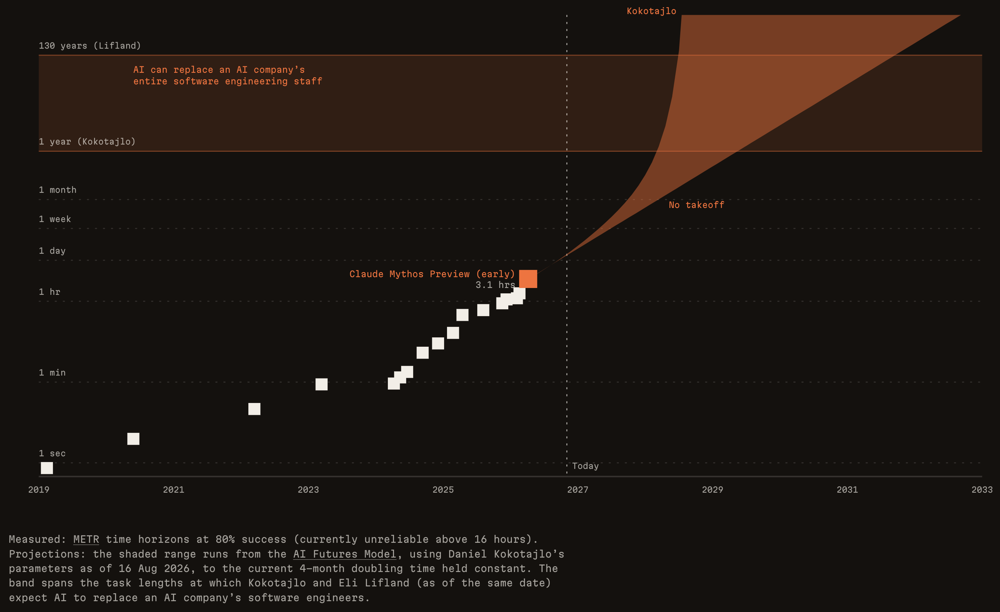
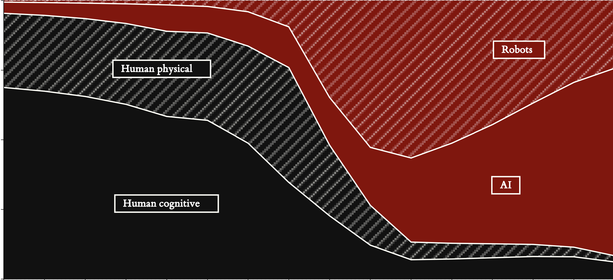
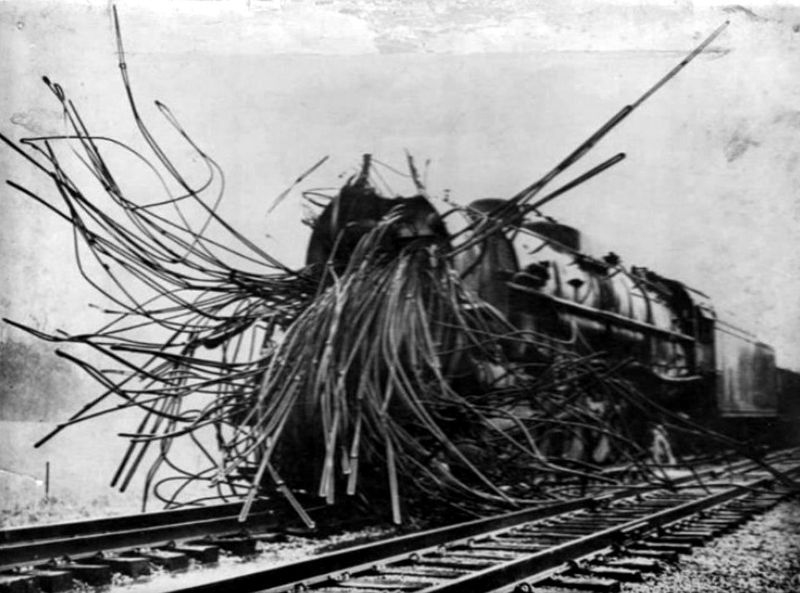
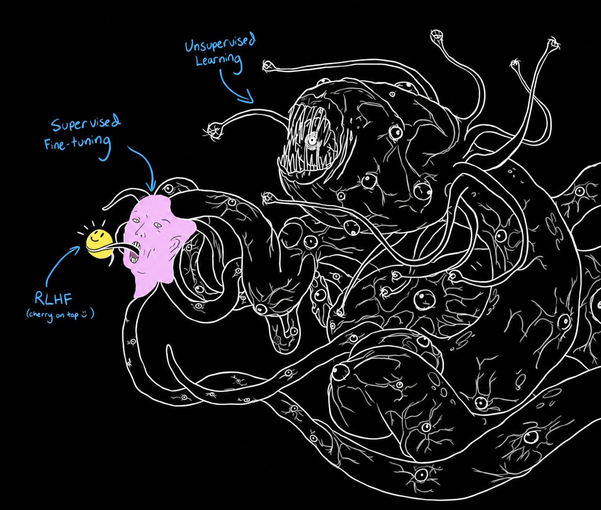
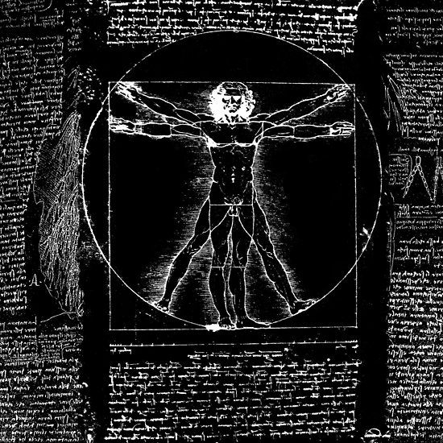
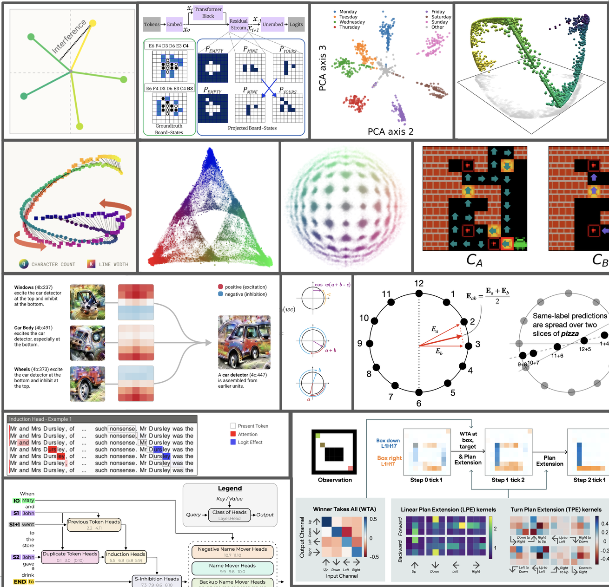
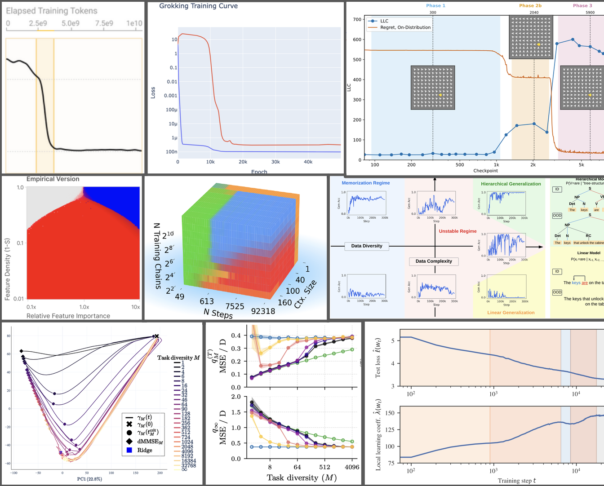
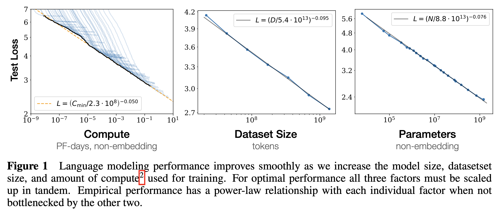
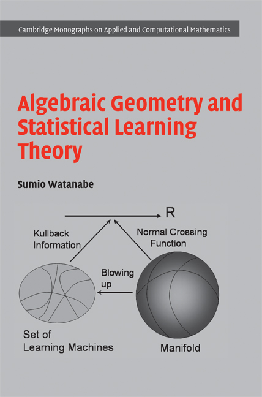
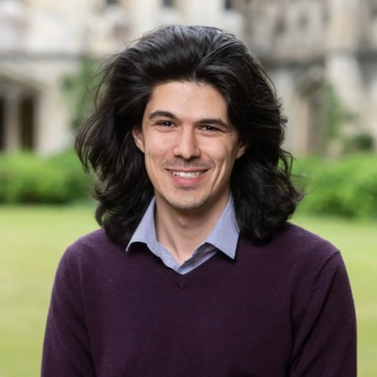

## Today

::: centered

**16:05--16:50:**  
Lecture 1A: Motivation

**16:50--17:00:**  
*Break*

**17:00--18:00:**  
Lecture 1B: Degeneracy

:::

## Lecture 1A: Motivation

Lecture questions:

1. How is AI changing mathematics, science, and the world?

2. What can/should a young mathematician/scientist do about that?

3. What does it mean to understand deep learning?

4. What is singular learning theory, and how might it help?

5. What exactly will we learn in this course, and how will we do it?

<!-- It's a difficult time to motivate the study of mathematics, but here goes
nothing -->

# What is going on in the world? {data-ornament="cusp-5"}

## AI is getting good {.split}

It's debatable whether AGI has been achieved, but clearly this year's AI
systems are operating at human expert level in technical domains:

* Software: Project Glasswing et al., unreleased models breaking out of
  containment and into Hugging Face.
* Mathematics: Navier--Stokes, Exponential Time Hypothesis, among other
  claimed results.
* AI R&D: Frontier labs gearing up for recursive self-improvement.

---

Major releases multiple times a year. Progress trends are towards increasing
autonomy.

## Mathematics is being disrupted

A few months ago, AI math outputs were widely dismissed as "slop."

Now, AI mathematicians are more careful than some human mathematicians, and
also have the patience to formally verify their work.

The field is re-evaluating what is important and what its priorities are: some
open problems are worth more before they are closed.

Humans retreating to:

* Framing conjectures, assessing mathematical beauty.
* Manually verifying that AI didn't cheat.
* Exegesis of AI-derived proofs.

Right now, brute force is in surplus; human taste and understanding are bottlenecks.

## More dramatic disruption coming soon?

**Recently:** Unintended socially disruptive AI incidents of escalating
severity:

* Unintended meltdowns leading to outbursts against users (Bing, Grok)
* Unintended sycophancy leading to AI-induced psychotic episodes (esp. GPT-4o).
* Unintended evaluation hacking and swarming behaviours leading to industrial
  cybercrimes (various internal models).

**In a future** where human-expert-level AI capabilities broaden beyond
mathematics and cybersecurity...

* ...to biology: possibility of unintended pandemics or other biological
  catastrophes.
* ...to persuasion: possibility of mass psychosis or political influence
  campaigns.
* ...to military technology: possibility to tip the balance of world powers (or
  threaten to).

# What can you do about it? {data-ornament="cusp"}

## Framework 1: Prepare for the future?

Preparing for the future is *really really* hard.

The future is really uncertain! And it looks like it could be quite grim!

* Will humans need to understand mathematics to advance it?
  * What if AI can frame conjectures and evaluate beauty faster and better than
    me?
  * What if AI can understand mathematics more deeply than I ever could anyway?
* Will the global economy continue to support my life?
  * Maybe I should earn money as fast as possible to escape the "permanent
    underclass."
  * Maybe I should become self-sufficient and go off-grid as soon as possible.
* Maybe there's nothing to worry about and this will all blow over?

## Framework 2: Seize the present?

Waking up to the present day is much more achievable!

Ask yourself these questions:

* Am I spending my days as if the world is probably going to be the same,
  despite advances that have already happened?
  * (Consider being less attached to traditional pathways in life, even if you
    have followed them this far?)
* Am I making the most of the new possibilities that currently existing AI has
  already created?
  * (The answer may be yes, even if you aren't using any AI, but that gets less
    defensible over time.)

## What should you do with your day? {.sidebar}

The future hasn't been written. Therefore, you might still be able to influence
it for the better.

Here is a brainstorm:

* Take time to develop your own knowledge and strategy around the future of AI.

* Support political efforts to carefully coordinate AI technology.
  <!-- It doesn't really seem fair that the AI industry can force this
  disruption upon us, maybe we should find a way to prevent or slow that.-->

* Develop and/or contribute your talents to the field of *AI safety.*
  <!-- the community of people trying to make AI that doesn't destroy the
  world.-->

In particular: Make the most of the current landscape in mathematics/science.
<!--Mine silver linings while you can.-->

---

# What is going on inside AI systems? {data-ornament="parabola"}

## Grown, not programmed {.sidebar}

There are many technical & social challenges involved in making sure AI doesn't
destroy the world.

Among them, we probably want **more robust and precise control over AI system
behaviour.**

In other foundational technological industries (aerospace, civil
infrastructure, transportation, manufacturing, ...), engineers have a **deep
understanding** in the form of **scientific principles** guiding their system
designs.

<!--
* Power generation, including nuclear, and power distribution
* Infrastructure, including tunnels and skyscrapers
* Airplanes and rocketships
-->

In AI, labs disclaim "our models are grown, not programmed," and so it's no
surprise that we see unintended unsafe behavioural outbursts.

---

## Laws of AI system behaviour? {.split}

So what deep scientific principles can our engineers look to for guidance
designing AI system behaviour?

Unfortunately, the science of AI behaviour is primitive:

* Classical theory does not predict the empirical success of scaling up neural
  networks.

* AI engineers follow heuristics to assemble data sets and objectives, design
  architectures, and set hyperparameters.

---

## Signs of structure: Mechanistic interpretability {.split}

*Sometimes,* trained neural networks display interpretable and causally relevant
computational structure.

* Features: interpretable internal representations of relevant variables.
* Circuits: operate on these representations using interpretable algorithms.

In some cases, different models/architectures learn similar structures.

---

## Signs of structure: Phase transitions {.split}

<!--However, the naturalists have been hard at work.-->

Sometimes, behaviour/mechanisms change rapidly in response to changes in:

* Data composition.

* Training time (so-called "developmental" interpretability).

This suggests that *some principles* explain what kind of data and what amount
of compute give rise to one internal structure or another.

---

## Signs of structure: Scaling laws {.split}

Neural network behaviour (test loss) as a function of scale is predictable,
empirically, over many orders of magnitude.

"Scale" here means a combination of increasing:

* Dataset size (number of unique data points).

* Model size (number of weights).

* Amount of compute (number of steps, number of data points processed per step).

---

<video data-autoplay loop muted playsinline src="media/parity-scaling-animation.mp4"></video>

## Towards a cognitive turn in deep learning

<!-- We might draw inspiration from the history of psychology -->

Roughly speaking, classical learning theory is built for lookup tables with no
internal structure.

To understand deep learning, we might need to think more about computational
structure:

Questions:

1. Why do we find certain mechanisms, or not?

2. What are general axes of variation for emergent mechanisms?

3. How do emergent mechanisms change with scale?

Answering these questions might clarify which methods to use to make safe AI.

# What is singular learning theory? {data-ornament="triple-crossing"}

## Classical statistics assumes local non-degeneracy {.sidebar}

One framework for understanding learning systems is **statistics.**

Classical results offer helpful guarantees:

* Asymptotic normality of Bayesian posterior.
* Bayesian information criterion (BIC) guides model selection.

But these results require strong regularity assumptions:

* Different parameters describe different predictive distributions.
* Near the "true parameter", loss is quadratic.

---

<slt-regular-model width="300"></slt-regular-model>

## Neural networks are very degenerate {.sidebar}

Neural networks break these regularity assumptions:

* Different parameters can describe the **same predictive distribution**,
  including **redundantly.**
* At degenerate points, the quadratic approximation can fail.

Classical statistical results break down at degenerate points:

* The Bayesian posterior is not asymptotically normal.
* The BIC is not an appropriate guide to model selection.

---

<slt-singular-model width="300"></slt-singular-model>

## Algebraic geometry and statistical learning theory {.sidebar}

Sumio Watanabe applied tools from algebraic geometry and stochastic processes
to nevertheless study Bayesian inference in statistical models with
degeneracies:

* Transforms of singular integrals.
* *Resolution of singularities* from algebraic geometry simplifies the singular
  integrals so they can be solved.
* Convergence of stochastic processes bounds fluctuation introduced by sampling
  data.
* Contributions from degenerate points dominate asymptotic expansion.

**Geometric structure of degeneracies appears in laws of Bayesian learning.**

---

{width=200}

{width=200}

## Singular learning theory {.split}

Watanabe's SLT:

> Using techniques from algebraic geometry, understand the role of degeneracy
> in **Bayesian learning.**

Important core theorems established:

* Bayesian free energy expansion.
* Bayesian generalisation error.
* Variational inference, MAP, &c...

---

Modern SLT:

> Using techniques from algebraic geometry, understand the role of degeneracy
> in **learning in general, e.g., deep learning.**

Active, ongoing project:

* Theory of gradient-based learning.
* Experiments connecting algebraic geometry and deep learning.
* Applications in interpretability.
* Implications for AI safety.

<!-- working up to frontier scale -->

# What is this course? {data-ornament="normal-crossings"}

## Syllabus

Mathematical foundations of SLT and its application to neural network training
dynamics.

1. **Degeneracy:** Understand definitions of degeneracy and where degeneracy
   arises in neural networks.
2. **Algebraic geometry:** Understand the mathematical definition of a
   singularity, the resolution of singularities theorem, and the blow-up
   technique.
3. **Local learning coefficient:** Understand the central quantity in
   Watanabe's SLT and how it is defined via the resolution.
4. **Bayesian SLT:** Understand Watanabe's free energy expansion and its
   implications for Bayesian learning.
5. **Modern SLT:** Understand how we study deep neural networks and
   gradient-based training from an SLT perspective.

## Structure {.sidebar}

**Lectures:**

* Here in Bill Roscoe Lecture Theatre.
* 16:00--18:00 (except week 6 / lecture 3, 17:00--19:00).
* Your lecturers: Myself, Aurelio, Kai, Miguel.

**Problem sets:**

* Each week's lecture notes will come with a series of exercises.
* We can't provide dedicated tutorial time, but we provide written solutions.
* We highly recommend working through (by yourself, or in groups, or with an
  LLM tutor).

---

::: headshots

  Matthew

 Aurelio

      Kai

   Miguel

:::

## Research mini-project

From the announcement email:

> By the end of the course, you'll be equipped to begin contributing to SLT
> research and to join a growing community in Oxford working on these
> questions.

<!-- We mean it! The above syllabus will bring you close to the research
frontier of modern SLT -->

At the end of the course, we recommend trying a research mini-project over the
vacation.

* Work individually or in groups.
* Replicate and extend a paper on SLT.
* Write a 4--8 page technical report / workshop paper.
* Depending on interest, we may be able to offer compute support and/or cash
  prizes for the best reports (TBC).

<!-- We can't offer you credit towards your degrees for participating in this
course, but we did just receive funding for the project, £2000 pounds to run a
project.-->

<!-- OK, by now I hope you're motivated to get started; but it has been a
while, let's have a 10 minute break! -->

# *break* {data-ornament="punctured-axes"}

